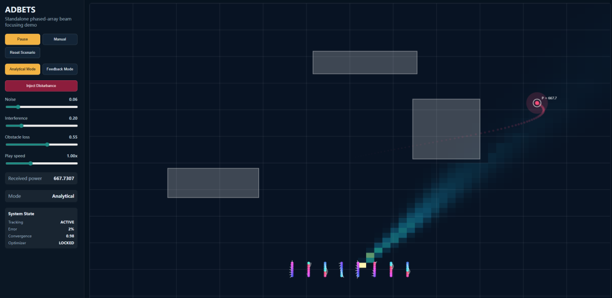

# [System Design] Intelligent Phased Array Beamforming: Letting Wireless Signals Precisely "Follow" the Target

Intelligent Phased Array Beamforming: Ensuring Wireless Signals Accurately "Track" Targets in Wireless Communication and Radar Probing, among other fields, has always been a core direction for technological breakthroughs. Today, I want to share with you the Phased Array Beamforming Simulation System that was developed to address this issue - it can simulate signal propagation in real-world environments, optimize antenna phases through intelligent algorithms, making signals "see" like they have eyes, precisely lock onto the receiving end.

I. Core Principle: From "Ideal" to "Realistic" Signal Control
1. The Foundation of Phased Array: Making Waves "Step in Unison": The system's core is an 8×8 phased array antenna, where each antenna element can independently adjust the phase of the signal. In an ideal scenario, the propagation path from the antenna to the receiving end has a fixed phase difference. By setting the corresponding compensation phase for each antenna element, all signal waves can "step in unison" at the receiving end, achieving maximum signal strength. This is like the precision coordination of members in a choir, producing a more powerful harmony than solo singing.
2. Challenges in Real Environments: Interference and Obstacles
However, in reality, signal propagation never goes "unimpeded":
- Reflection Loss: Walls, buildings, etc., weaken signals; once the signal path passes through these areas, its intensity significantly drops;
- Adaptive Optimization: Making the algorithm "actively find the optimal solution"
To adapt to complex environments, the system introduces an intelligent adaptive optimization algorithm. It no longer relies on fixed ideal phases but starts with them, continuously adjusting through "trial - evaluation - iteration" methods:
- Randomly adjust the phase of some antenna elements, forming new phase combinations;
- Calculate the received signal power under the new combination, assessing the effect;
Retain the phase configuration that enhances signal strength. At the same time, gradually reduce the adjustment range. Let the algorithm converge to the optimal solution; Even in the presence of noise. In environments with obstructions. It can also pass hundreds of iterations. Find the optimal phase scheme at the current moment. Keep the signal power at the receiving end always high.
II. What can the system do? Restore the real signal propagation scenario. This simulation system is not just a simple theoretical calculation, but it can fully replicate the signal behavior in real-life environments:
1. Environmental simulation: Replicate the real transmission conditions system can be customized to set the position of obstacles. Size and decay degree. It can also adjust environmental noise. External interference sources' intensity - for example, the occlusion of multiple buildings in a simulated city. Or the complex electromagnetic interference in the mall. Make the simulation results as close to the real scene as possible.
2. Signal Visualization: The "Signal Distribution" system will convert the entire space's signal power into a visual heatmap, allowing us to clearly see:
How the signals emitted by an antenna array propagate in space;
How obstructions "block" signals;
How to optimize the beam so that it can precisely focus on the receiving end, while significantly reducing the signal strength in other areas.
III. Why is this system valuable? From technical validation to practical application, the value of this simulation system is reflected in multiple dimensions:
Visual verification of algorithm effectiveness: Comparing the received power of "ideal phase" and "adaptive optimized phase", it is clearly seen that the algorithm gains in complex environments, providing data support for the iteration of the algorithm.
Reduce R&D costs: Without the need to build an actual antenna array, it can simulate signal performance under different scenarios (such as different obstacles and interference intensities), significantly reducing experimental costs.
Close to practical application: whether it is the optimization of base station in mobile communication, Still, the radar's target lock. The simulation logic of this system can correspond to real scenarios. Provides a reference for the actual implementation of projects.
IV. Behind the Logic: From Simulation to Application, a Complete Technical Loop Forms:
1  
Simulation Engine: Responsible for modeling antenna arrays, signal propagation, and environmental attenuation, serving as the foundation for all calculations.
2  
Control Algorithm: Connecting ideal phase calculation with adaptive optimization is the core of precise signal regulation;  
3  
Interaction and Visualization: Through intuitive heat maps and real-time parameter displays, technicians can quickly understand signal behavior and adjust simulation parameters.  
In conclusion, this phased array beamforming simulation system is essentially a "theoretical algorithm" and "real environment" bridge. It allows us to break free from ideal assumptions and face complex real conditions directly, through intelligent optimization making wireless signal propagation more accurate and stable. The core logic behind this - from "passive adaptation" to "active optimization", is also the key idea for continuous breakthroughs in wireless communication technology.  
In the future, with further iteration of algorithms and support for more complex environments (such as multiple receivers, dynamic obstacles), such simulation systems will play a greater role in fields such as 5G/6G communication, smart radar, satellite communication, etc., allowing wireless signals to truly achieve "on-demand allocation, precise delivery".

## Images

<!-- PAYMENT_BLOCK -->

## Get this dataset

- Payment link (Stripe): [Buy now](https://buy.stripe.com/3cs8yP7sY87d0vu9AB)
- Payment QR code: 

<!-- /PAYMENT_BLOCK -->
